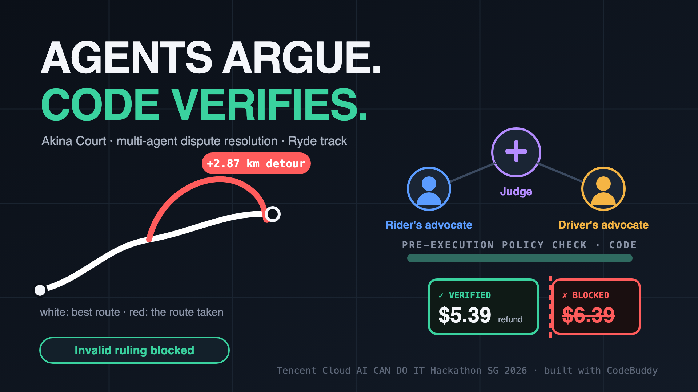
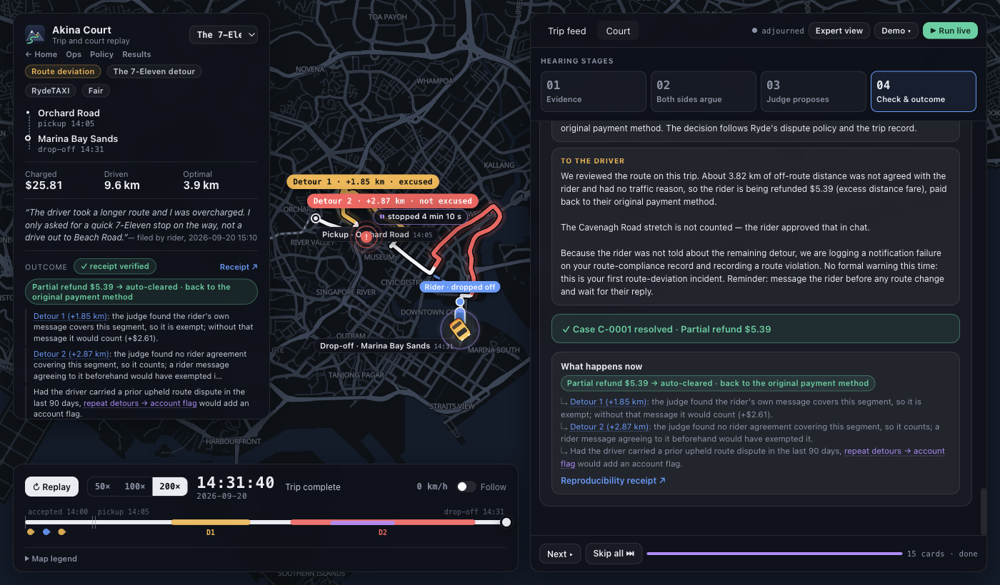
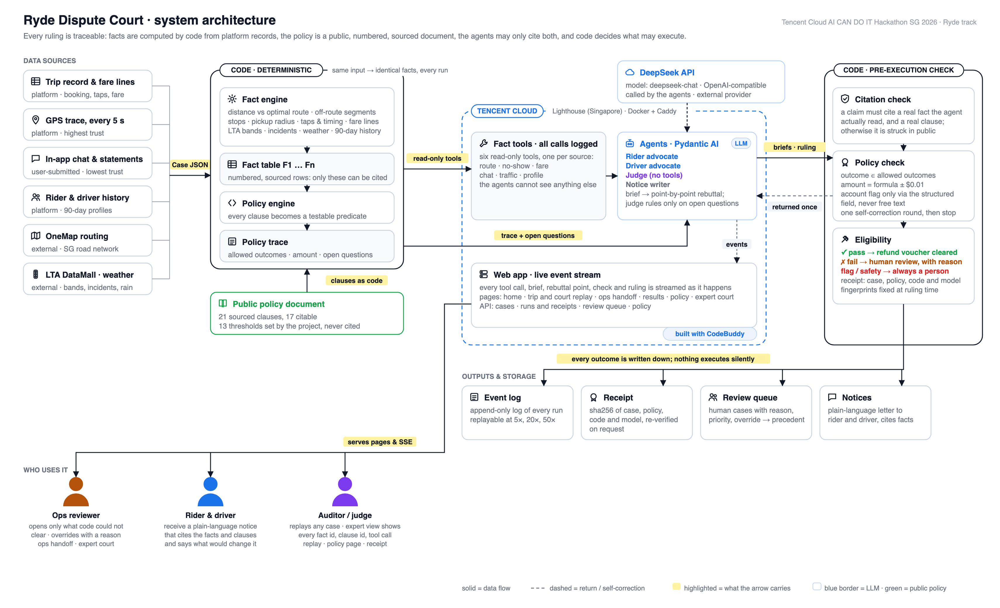

# Akina Court · Ryde Dispute Court



**Agents argue. Code verifies.** A rider says the driver took the long way. Akina Court reads the trip record, lets an AI advocate for each side argue the case before an AI judge, and gives Ryde a ruling in about <!--n:court.latency_mean_s:.0f-->26<!--/n--> seconds that both sides can check. A refund only goes out when code confirms the ruling follows Ryde's written policy; anything the record cannot settle goes to a person, with the case already prepared.

| | |
|---|---|
| Live demo | https://akina.kalitas.cc |
| Watch one case, map and court | https://akina.kalitas.cc/replay.html?case=C-0001 |
| Full results | https://akina.kalitas.cc/report.html |
| Demo video | *coming soon* |
| Track | Ryde · Multi-Agent Autonomous Dispute Resolution |
| Built with | CodeBuddy · DeepSeek API (deepseek-chat) · Tencent Cloud Lighthouse |

## At a glance

One complaint. A GPS trace, a chat log, a fare breakdown, traffic and weather records, both parties' histories. Ryde's published rules. Today a person reads all of it, and it takes 24–72 hours per dispute ([Ryde track brief](docs/tencent-hackathon-sg-2026-handbook.txt)).

We ran <!--n:cases-->65<!--/n--> synthetic disputes (<!--n:types.route_deviation-->42<!--/n--> route deviation, <!--n:types.no_show-->18<!--/n--> no-show, <!--n:types.safety-->5<!--/n--> safety) through the same model three ways:

| | Ask the AI once | AI judge + policy check | **Akina Court** |
|---|---|---|---|
| Right, or handed to a person | <!--n:arms.raw.safe-->34<!--/n-->/<!--n:cases-->65<!--/n--> | <!--n:arms.judge_only.safe-->58<!--/n-->/<!--n:cases-->65<!--/n--> | **<!--n:arms.court.safe-->65<!--/n-->/<!--n:cases-->65<!--/n-->** |
| Wrong decision that was carried out | <!--n:arms.raw.wrong_executed_single_call-->31<!--/n-->/<!--n:cases-->65<!--/n--> | <!--n:arms.judge_only.wrong_and_executed_with_gate-->7<!--/n-->/<!--n:cases-->65<!--/n--> | **<!--n:arms.court.wrong_and_executed_with_gate-->0<!--/n-->/<!--n:cases-->65<!--/n-->** |
| Settled with no person involved | – | <!--n:arms.judge_only.auto-->46<!--/n-->/<!--n:cases-->65<!--/n--> | **<!--n:arms.court.auto-->42<!--/n-->/<!--n:cases-->65<!--/n-->** |

"Right" means the outcome, the amount (to the cent) and the hand-off decision all match a reference answer derived from Ryde's written policy, never from a model. A case handed to a person is not counted as wrong: a reviewer decides it. On <!--n:blind.cases-->12<!--/n--> held-out cases written after the prompts were frozen, the court matched <!--n:blind.court.exact-->11<!--/n-->/<!--n:blind.cases-->12<!--/n--> and carried out <!--n:blind.court.wrong_executed-->0<!--/n-->/<!--n:blind.cases-->12<!--/n--> wrong decisions.

## Inspiration

Ryde's brief names the cost of today's process: slow resolutions, and different agents reaching different conclusions on similar cases. A chatbot does not fix the second problem. Asked once, a model reads the chat well but applies rules from memory, adds up kilometres it cannot see, and gives a different answer on a different day; nothing about its ruling can be audited.

We wanted a courtroom instead of a chatbot: every fact measured once by code, every rule written down with its source, two sides arguing in the open, and a judge who can only rule on what was argued. If a ruling cannot be checked, it should not move money.

## What it does



- **A dispute is filed** with the trip record: GPS against the best OneMap route, taps, fare lines, LTA speed bands and incidents, weather, chat and calls, both parties' histories.
- **Code turns the record into numbered facts** (the detour's extra kilometres, minutes waited, who confirmed arrival when) and works out which of Ryde's clauses apply, which clearly do not, and which questions only a reading of the chat can answer.
- **The Rider Advocate and the Driver Advocate** gather evidence through logged tools, write briefs that cite fact and clause numbers, and rebut each other. Each must say which policy ground its reading rests on.
- **The Judge** rules only on the open questions, chooses between the grounds the two sides argued, and writes a plain-language notice to each party.
- **Code checks the ruling before anything happens**: every cited number exists, the outcome is one the policy allows, the amount matches the policy formula to the cent. Pass: the refund voucher goes out. Fail, unclear evidence or any safety concern: a person decides.
- **Every step is replayable**, on the map and in the court feed, and every ruling carries a receipt that shows if the case, the policy, the code or the model has changed since.

Three dispute types: route deviation, no-show and cancellation fees, and safety (always handed to a person). The organisers' own sample (`data/samples/DISP-002.md`) imports as is and runs through the same court: the $<!--n:demo.disp002_fee:.2f-->5.00<!--/n--> cancellation charge is upheld, as the sample's expected ruling states.

## How we built it



1. **Facts by code** (`core/facts/tools.py`). The same record always gives the same numbered fact table. Chat and statements are copied word for word with their times; what a message *means* is never decided by code. Missing evidence, such as a hole in the GPS trace, is itself a fact.
2. **Policy as code** (`core/policy_engine.py`). <!--n:policy.clauses-->21<!--/n--> numbered clauses, each with the document it comes from, most of them Ryde's own published terms. Before any model speaks, code decides the allowed outcomes, the refund formula and the questions left open.
3. **Three agents** (`core/agents/`). Two advocates with tools and one judge without, each a separate role with its own contract. A ground both advocates agree on binds the judge; a finding on a ground nobody argued is sent back once, then goes to a person.
4. **A check before execution** (`core/verify.py`, `core/receipt.py`). The ruling is checked item by item against the policy. An account penalty can only come from a structured field, never from the judge's free text, and always goes to a person.

### Why we did not let the model decide alone

| What a ruling needs | Who does it | Why |
|---|---|---|
| Distances, times, fares | Code | The same input must give the same number, and a model's arithmetic cannot be audited |
| Which rules apply | Code | A ruling should rest on the written policy, not on the model's memory of it |
| What a message means (did the rider agree? is this a threat?) | The advocates and the judge | Keyword rules misread people: "I'll find you at the lobby" is a pickup, not a threat |
| Whether money moves | Code check | Only a ruling that agrees with the policy is carried out |
| Account penalties | Always a person | A sentence in the model's text must never be able to punish anyone |

## The finding that shaped the design

The benchmark told us where the errors were, and it was not where we expected.

1. **Clean facts alone did not help.** Giving the model our code-computed fact table instead of the raw record left it exactly where it was: <!--n:arms.facts_only.safe-->34<!--/n-->/<!--n:cases-->65<!--/n--> right or handed to a person, the same as <!--n:arms.raw.safe-->34<!--/n-->/<!--n:cases-->65<!--/n--> for the raw record. The mistakes were in applying the policy, not in reading the data.
2. **A code check stops most wrong decisions.** A judge whose ruling must pass the policy check carried out <!--n:arms.judge_only.wrong_and_executed_with_gate-->7<!--/n--> wrong decisions instead of <!--n:arms.raw.wrong_executed_single_call-->31<!--/n-->.
3. **The rest were all one question: what did the rider agree to?** "Sure" to "can I go via Sims Avenue?" covers Sims Avenue only, and GPS does not name roads. A single judge kept guessing. With two advocates who must each state the ground of their reading, and a judge who may only rule on an argued ground, wrong decisions carried out fell to <!--n:arms.court.wrong_and_executed_with_gate-->0<!--/n-->: when the record cannot tie the driven stretch to the agreed road, the court says so and a person decides.

## Challenges we ran into

- **Consent is a reading, not a measurement.** "Sure" can agree to a road, to a stop, or to any faster way, and the GPS trace names no roads. A finding the record cannot support is now "undetermined" and goes to a person instead of being guessed.
- **Keyword rules.** An early version flagged chat messages by keyword and marked an ordinary pickup message as a threat. We removed every keyword label; meaning is read by the agents.
- **Testing our own test set.** Some generated detours did not really bypass the incident they claimed to avoid. We added checks to the generator and log every change to a reference answer in `data/bench/REFERENCE_CHANGES.md`.
- **Text that could punish.** An account flag written into the judge's free text could have triggered a penalty. Account actions now come only from a structured field, and a stored fault injection shows that free text cannot trigger one.
- **Knowing which model answered.** The API labels its served model `<!--n:provenance.served_model-->deepseek-flash<!--/n-->` while we request `deepseek-chat`; every stored response keeps both ids and the API's own trace ids.

## Accomplishments that we're proud of

- <!--n:arms.court.wrong_and_executed_with_gate-->0<!--/n-->/<!--n:cases-->65<!--/n--> wrong decisions carried out, and <!--n:blind.court.wrong_executed-->0<!--/n-->/<!--n:blind.cases-->12<!--/n--> on the held-out set.
- <!--n:per_arm.court.cites_invalid-->0<!--/n--> invalid citations in <!--n:per_arm.court.cites_total-->1242<!--/n--> across the benchmark: every number the agents cite is a real fact or clause.
- Deliberate tampering with the AI's output (a fact that does not exist, an invented clause, a changed amount, a hidden account flag) and a prompt injection planted in the chat are all caught; each is a stored replay on the live site.
- The organisers' sample runs unchanged through the same court and reaches the expected ruling.

## What we learned

- Let code measure and let the model read meaning. Each is reliable only at its own job.
- "Hand it to a person" is a valid answer. Counting it as a failure pushes a system to guess.
- A benchmark you wrote yourself needs its own audit trail: reference answers derived from the policy, a change log, and a held-out set written after the prompts were frozen.

## Limitations

Synthetic cases on real OneMap road geometry, not real Ryde tickets. One model. Reference answers are derived from the written policy, so they measure conformance to that policy, not agreement with a human operations team. The benchmark was extended after the first results had been seen; this is disclosed on the results page, and the held-out set is scored separately. Refunds are issued as vouchers; account actions always go to a person. Where Ryde publishes no value (for example how far off the route counts as a detour), the project sets one: <!--n:policy.gaps-->13<!--/n--> such thresholds are listed on the policy page for Ryde to adjust.

## What's next for Akina Court

- Real Ryde tickets and a reference set labelled by Ryde's own agents.
- Road names matched to the GPS trace, so "which road did the car take" becomes a fact instead of an open question.
- Asking the trip service for missing GPS before handing a case off (a preview is in `core/evidence.py`).
- Photo evidence for cleaning fees, and a review page for account actions.

## Run it yourself

```bash
docker build -t akina-court . && docker run --rm -p 8000:8000 -e LIVE_RUNS=0 akina-court
# open http://localhost:8000
```

That is the whole site with every stored hearing, and it needs no key. To run the court live, clone the repository, put a `DEEPSEEK_API_KEY` in `.env` (template: `.env.example`) and press **Run live** on the replay page, or run `scripts/run_case.py C-0001`: you get a fresh ruling and a fresh receipt to compare with the stored one.

## Check the numbers yourself

`.venv/bin/python bench/provenance.py --hashes` recomputes the results from the run files: <!--n:provenance.runs-->260<!--/n--> stored case-system runs and <!--n:provenance.calls_c-->622<!--/n--> recorded model calls, <!--n:provenance.window-->2026-10-10 17:35 to 2026-10-11 02:37 UTC<!--/n-->. Every court case keeps the full event log of its hearing, e.g. `bench/results/court/B-0024.record.json`; <!--n:provenance.audit_runs-->20<!--/n--> further runs keep the exact requests and raw responses in `bench/results/audit_sample/`.

## For AI agents

Paste to your coding agent: *"Read the For AI agents section of README.md and deploy the demo."*

1. **Install and test:** `python3 -m venv .venv && .venv/bin/pip install -r requirements.txt && .venv/bin/python -m pytest -q` (Python 3.11+, expect no failures).
2. **Run:** `LIVE_RUNS=0 .venv/bin/python -m uvicorn app.main:app --port 8000`; `curl localhost:8000/api/health` returns `{"ok": true, ...}`.
3. **Deploy:** `docker build -t akina-court . && docker run -d -p 8000:8000 -e LIVE_RUNS=0 akina-court`. For HTTPS on a domain, set `LIVE_RUNS=0` and `DOMAIN` in `deploy/.env`, then `cd deploy && docker compose up -d --build`. Keep one worker.
4. **Live rulings:** add `DEEPSEEK_API_KEY` to `.env` and start without `LIVE_RUNS=0`.

<details>
<summary>All four systems, in detail</summary>

| | Raw LLM, one call | Facts by code, one call | Judge + policy check | Full court |
|---|---|---|---|---|
| Right, or handed to a person | <!--n:arms.raw.safe-->34<!--/n-->/<!--n:cases-->65<!--/n--> | <!--n:arms.facts_only.safe-->34<!--/n-->/<!--n:cases-->65<!--/n--> | <!--n:arms.judge_only.safe-->58<!--/n-->/<!--n:cases-->65<!--/n--> | **<!--n:arms.court.safe-->65<!--/n-->/<!--n:cases-->65<!--/n-->** |
| Wrong decision **and executed** | <!--n:arms.raw.wrong_executed_single_call-->31<!--/n-->/<!--n:cases-->65<!--/n--> | <!--n:arms.facts_only.wrong_executed_single_call-->31<!--/n-->/<!--n:cases-->65<!--/n--> | <!--n:arms.judge_only.wrong_and_executed_with_gate-->7<!--/n-->/<!--n:cases-->65<!--/n--> | **<!--n:arms.court.wrong_and_executed_with_gate-->0<!--/n-->/<!--n:cases-->65<!--/n-->** |
| Cleared automatically | – | – | <!--n:arms.judge_only.auto-->46<!--/n-->/<!--n:cases-->65<!--/n--> | **<!--n:arms.court.auto-->42<!--/n-->/<!--n:cases-->65<!--/n-->** |
| Invalid citations (fact + clause ids) | <!--n:per_arm.raw.cites_invalid-->29<!--/n--> / <!--n:per_arm.raw.cites_total-->309<!--/n--> | <!--n:per_arm.facts_only.cites_invalid-->2<!--/n--> / <!--n:per_arm.facts_only.cites_total-->1098<!--/n--> | <!--n:per_arm.judge_only.cites_invalid-->0<!--/n--> / <!--n:per_arm.judge_only.cites_total-->1141<!--/n--> | **<!--n:per_arm.court.cites_invalid-->0<!--/n--> / <!--n:per_arm.court.cites_total-->1242<!--/n-->** |
| Mean time | <!--n:per_arm.raw.latency_mean_s:.1f-->7.2<!--/n--> s | <!--n:per_arm.facts_only.latency_mean_s:.1f-->6.4<!--/n--> s | <!--n:per_arm.judge_only.latency_mean_s:.1f-->8.6<!--/n--> s | <!--n:per_arm.court.latency_mean_s:.1f-->26.5<!--/n--> s per case |

Per-case tables, ablations and caveats: `/report.html`.
</details>

<details>
<summary>Pages and repository map</summary>

- `/` landing · `/replay.html?case=C-0001` map replay and court (`&phase=court`, `&cf=<counterfactual>`, `&run=<stored run>`) · `/facts.html` the fact table of a case · `/policy.html` the clauses with sources and the project's thresholds · `/ops.html` what reaches a person · `/report.html` results · `/submission.json` machine-readable claims

| path | what |
|---|---|
| `core/facts/tools.py` · `core/policy_engine.py` | facts by code; clauses as code, allowed outcomes, amount formula, open questions |
| `core/agents/` · `core/verify.py` · `core/orchestrate.py` | advocates, judge, notice writer; checks; the hearing |
| `policy/` | <!--n:policy.clauses-->21<!--/n--> sourced clauses + <!--n:policy.gaps-->13<!--/n--> project thresholds; `clauses_en.json` behind `/policy.html` |
| `data/` · `runs/` | demo cases, benchmark and held-out sets with reference answers, stored runs |
| `bench/` · `scripts/` · `tests/` | benchmark runner, scoring, pages; command-line runner; offline tests |
| `web/` · `app/main.py` · `deploy/` | pages; FastAPI + server-sent events; Docker, Caddy, Lighthouse helper |
</details>

## Built with

- **CodeBuddy**: the whole project was developed with it; conversation screenshots and a short development reflection are part of the submission package
- **DeepSeek API** (deepseek-chat): the model behind the advocates and the judge
- **Python**, **FastAPI** with server-sent events for the live hearing, **pydantic-ai** for the agents
- **MapLibre** with **OneMap** routes for the map replay
- **Docker** and **Caddy** on **Tencent Cloud Lighthouse** for the live demo
- **Tencent Cloud ASR** for the voice-message case
